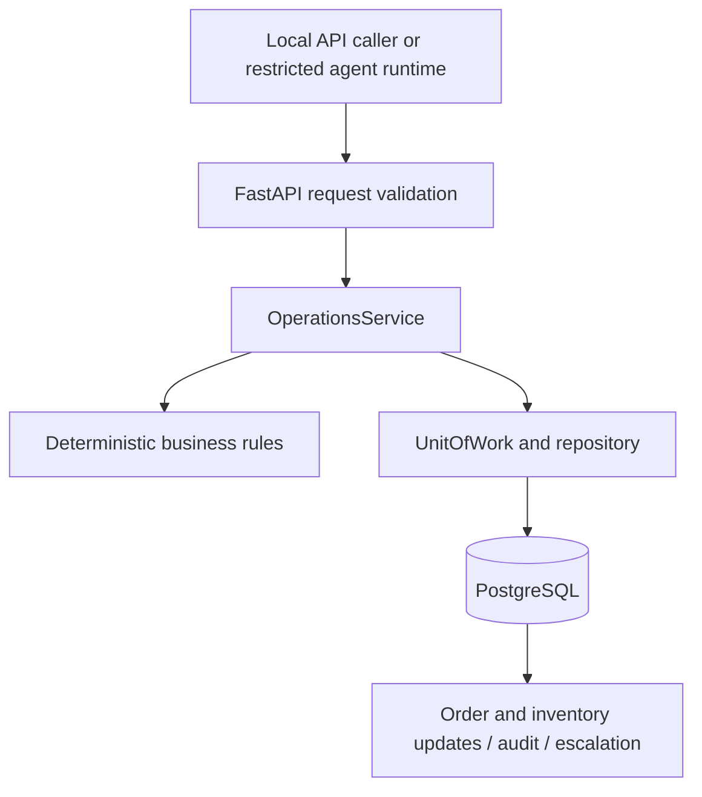

# OgaFlow AI

OgaFlow is an operations assistant for Nigerian small and medium-sized businesses. It is designed to help a business identify a customer, find their order, check payment evidence, reserve inventory, and confirm the order—or escalate the case for human review when the evidence is incomplete or inconsistent.

The central design rule is simple: an agent may request an action, but deterministic backend services decide whether that action is valid. Payment matching, stock deductions, state transitions, and audit records belong to the backend.

## Project status

This repository contains a working local backend and a restricted local agent compatibility harness. It is an implementation checkpoint, not a deployed production service.

| Area | Current implementation |
| --- | --- |
| Domain rules | Strict NGN/kobo amounts, payment matching, order transitions, and inventory validation |
| Persistence | PostgreSQL schema, synthetic seeds, transactions, row locking, audit records, and escalations |
| API | FastAPI endpoints for runs, lookups, payment checks, reservation, and confirmation |
| Retry handling | Persistent idempotency keys, stored results, request conflict detection, and duplicate-effect protection |
| Agent boundary | Local runtime context and authenticated callbacks for four restricted tools |
| Frontend | React + TypeScript + Vite starter; no operations dashboard or API integration yet |
| External integrations | BimpeAI, live payment providers, SMS/voice, and notifications are not connected |
| Production readiness | User authentication, production deployment, and hosted compatibility verification remain outstanding |

## How it works



Operational writes and their audit records share a transaction. Invalid operations roll back their business effects and record an escalation. Inventory reservations lock product rows and apply conditional decrements to prevent competing requests from overselling stock.

The domain state progression is:

```text
CREATED → AWAITING_PAYMENT → PAYMENT_VERIFIED → STOCK_RESERVED → CONFIRMED → FULFILMENT
```

States before fulfilment can transition to `ESCALATED`. The current API workflow ends at confirmation; fulfilment and notification orchestration are future work. A confirmed order does not yet mark its agent run complete.

### Business guarantees

- Money is stored as integer kobo. For example, ₦84,000 is `8400000`; floating-point monetary values are rejected.
- Automatic matching requires exactly one explicitly linked payment with the same customer, amount, and currency, plus successful status and trusted verification evidence.
- Missing, ambiguous, unlinked, or mismatched payment evidence requires human review.
- Stock reservation is all-or-nothing; repeated reservations and confirmations do not repeat business effects.
- Reusing an idempotency key with different arguments produces a conflict. Retrying the same invocation returns its original result.
- The service owns audit records. Callers cannot supply verified flags, stock totals, arbitrary order state, or raw provider evidence.

See [business rules](docs/business-rules.md) for exact invariants and [failure handling](docs/failure-matrix.md) for rejected scenarios.

## Technology stack

| Layer | Technologies |
| --- | --- |
| Backend | Python 3.10, FastAPI, Pydantic, Uvicorn |
| Database | PostgreSQL; psycopg 3 driver |
| Frontend scaffold | React 19, TypeScript 6, Vite 8 |
| Verification | pytest, pytest-asyncio, Ruff, ESLint, TypeScript build |

## Repository layout

```text
backend/
  app/
    agent/          Prompts, policies, tool definitions, runtime context, transport
    api/            Operational routes and restricted agent callbacks
    core/           Configuration, database access, errors, integration security
    models/         Domain entities, enums, and result types
    repositories/   PostgreSQL operations and transactional unit of work
    schemas/        API request/response validation
    services/       Business operations, order states, payment matching, verification
  tests/
    unit/           Isolated validation and business-rule tests
    integration/    Real PostgreSQL, API, persistence, and agent-boundary tests
    scenarios/      Synthetic demo domain scenarios
  frontend/         React/Vite starter application
  requirements.txt
  requirements-dev.txt
database/           SQL schema and synthetic seed data
docs/               Architecture, contracts, decisions, demo guides, and roadmap
scripts/            Local PostgreSQL lifecycle and demo database helpers
.env.example        Configuration template without credentials
pytest.ini          Test discovery and Python paths
```

## Getting started

Run backend commands from the repository root. The local database helper uses Unix sockets; the documented workflow targets macOS/Linux.

### 1. Clone and install Python dependencies

Python 3.10.11 is the previously verified interpreter; `.python-version` records the project version. PostgreSQL binaries must be available under `.local/postgres/bin` or on `PATH`. The optional frontend requires Node.js 20.19+ within the 20.x series, or Node.js 22.12+ (per Vite’s engine requirement), and npm.

```sh
git clone https://github.com/richyfabz/OgaflowAi.git
cd OgaflowAi
python3.10 -m venv .venv
.venv/bin/python -m pip install -r backend/requirements-dev.txt
cp .env.example .env
```

For backend runtime dependencies alone, use `backend/requirements.txt`. Most Python dependencies are currently unpinned; this repository does not yet provide a fully locked Python environment.

### 2. Configure the application

Settings are read from environment variables and an optional `.env` in the current working directory. Keep credentials in ignored local environment files.

| Variable | Default | Purpose |
| --- | --- | --- |
| `APP_NAME` | `OgaFlow` | API title and health response service name |
| `APP_ENV` | `development` | Environment; demo mode permits only `development` or `test` |
| `OGAFLOW_DEBUG` | `false` | Validated debug setting; unrelated host `DEBUG` is ignored |
| `DATABASE_URL` | Unconfigured | PostgreSQL connection string; local generation command below |
| `OGAFLOW_DEMO_MODE` | `false` | Allows explicitly labelled synthetic seed payment evidence |
| `FRONTEND_URL` | `http://localhost:5173` | Frontend URL setting; does not itself implement CORS or frontend integration |
| `API_BASE_URL` | `http://localhost:8000` | API base URL setting |
| `OGAFLOW_AGENT_BOUNDARY_ENABLED` | `false` | Enables restricted callbacks and blocks legacy operational routes |
| `OGAFLOW_TOOL_TOKEN` | Unconfigured | Bearer credential required for restricted callbacks |

`SUPABASE_URL`, `SUPABASE_KEY`, `BIMPEAI_API_KEY`, `SMS_API_KEY`, `VOICE_API_KEY`, and `AGENT_MODEL` are placeholders in the template for future integrations. Filling them in does not activate those integrations. The future BimpeAI Console credential is separate from the callback token.

### 3. Prepare PostgreSQL and start the API

## Local PostgreSQL setup

The verification build is PostgreSQL 16.15, installed entirely under ignored
`.local/`. No system service, TCP listener, Supabase credentials or SQLite is used.
Existing local PostgreSQL binaries on PATH also work with the cluster helper.
To reproduce the project-local source build (requires a C compiler and make):

```sh
mkdir -p .local/postgres-build
cd .local/postgres-build
curl --fail --location https://ftp.postgresql.org/pub/source/v16.15/postgresql-16.15.tar.bz2 -o postgresql-16.15.tar.bz2
curl --fail --location https://ftp.postgresql.org/pub/source/v16.15/postgresql-16.15.tar.bz2.sha256 -o postgresql-16.15.tar.bz2.sha256
shasum -a 256 -c postgresql-16.15.tar.bz2.sha256
LC_ALL=C tar -xjf postgresql-16.15.tar.bz2
cd postgresql-16.15
LC_ALL=C ./configure --prefix="$PWD/../../postgres" --without-icu --without-readline --without-zlib
LC_ALL=C make -j4
LC_ALL=C make install
cd ../../..
```

Initialize once, then seed once:

```sh
.venv/bin/python scripts/local_postgres.py start
.venv/bin/python scripts/demo_database.py init
.venv/bin/python scripts/demo_database.py seed
.venv/bin/pytest -q
```

The server uses a private Unix socket at `.local/pgsocket`, port identifier 55432,
and role `ogaflow_local`. Trust authentication is confined to the private socket
directory; this is a local test setup, not a production database configuration.
`init` deliberately fails if the schema already exists; `seed` fails on existing IDs.

Reset only the isolated demo database:

```sh
.venv/bin/python scripts/demo_database.py reset --confirm ogaflow_demo
```

This verifies the database name, role, Unix connection and exact server data directory
before transactionally clearing all eight demo tables and restoring seeds. It accepts
no remote DSN and ignores DATABASE_URL. Unit/integration tests use separate disposable
schemas; reset does not clear them. The earlier offline artifact helpers remain:

```sh
.venv/bin/python scripts/seed_demo.py
.venv/bin/python scripts/reset_demo.py --output /tmp/ogaflow-demo-fresh.sql
```

## Run the local API

```sh
export DATABASE_URL="$(.venv/bin/python scripts/demo_database.py dsn)"
export OGAFLOW_DEMO_MODE=true
.venv/bin/python -m uvicorn app.main:app --app-dir backend --reload
```

`OGAFLOW_DEMO_MODE` defaults false and is allowed only with APP_ENV=development/test.
It reads explicitly labelled seed payment evidence; no real verification is claimed.
Normal mode's provider adapter reports PAYMENT_PROVIDER_UNAVAILABLE.
The API lacks authentication by scope and must remain local. Start with `/docs` and
[API contracts](docs/api-contracts.md). No frontend changes are needed for this phase.

```sh
.venv/bin/python scripts/local_postgres.py status
.venv/bin/python scripts/local_postgres.py stop
```

## Try the API

With the API running, open [Swagger UI](http://localhost:8000/docs) or inspect `/openapi.json`. The following examples use default local mode with the restricted agent boundary disabled.

```sh
curl http://localhost:8000/health

curl -X POST http://localhost:8000/runs \
  -H 'Content-Type: application/json' \
  -d '{"phone":"DEMO-PHONE-001","idempotency_key":"demo-start-001"}'
```

Copy the returned `run_id` into the next request:

```sh
curl -X POST http://localhost:8000/tools/get_open_orders \
  -H 'Content-Type: application/json' \
  -d '{"run_id":"<returned-run-id>","idempotency_key":"demo-orders-001"}'
```

The happy-path synthetic customer is `CUS-001`, with order `OGA-1042`, payment `PAY-88921`, and three cartons totalling ₦84,000. The seed dataset also covers amount mismatch, missing/pending/failed payments, ambiguous payments, insufficient stock, multiple orders, and no open orders.

| Endpoint | Purpose / additional body fields |
| --- | --- |
| `GET /health` | Application liveness; does not establish database connectivity |
| `POST /runs` | Identify a customer and start a run; `phone`, `idempotency_key` |
| `GET /runs/{run_id}` | Read the run and ordered action summaries |
| `POST /tools/get_open_orders` | Find the customer's open order |
| `POST /tools/get_order` | Fetch a validated order; `order_id` |
| `POST /tools/find_payments` | Read payment summaries for the customer |
| `POST /tools/verify_payment` | Verify through the configured adapter; `payment_id` |
| `POST /tools/match_payment` | Match and persist payment linkage; `order_id` |
| `POST /tools/check_inventory` | Check availability without reservation; `order_id` |
| `POST /tools/reserve_inventory` | Transactionally reserve stock; `order_id` |
| `POST /tools/confirm_order` | Confirm an eligible order; `order_id` |
| `POST /tools/create_escalation` | Request human review; optional `order_id` |

Every `/tools/*` POST also requires `run_id` and `idempotency_key`. Use a distinct key for each logical action, retaining that key for retries. Use a new key to obtain a fresh read instead of replaying a stored snapshot.

A business rejection can return HTTP 200 with `status: FAILED`, `reason_code`, and `human_review_required: true`. Always inspect the result body. Invalid requests return 422; conflicting key reuse returns 409; missing database configuration or database unavailability returns 503. Full bodies, result contracts, and boundary-specific errors are documented in [API contracts](docs/api-contracts.md).

## Restricted agent integration

Phase 4A implements a local compatibility harness. **BimpeAI is not connected, and the five live compatibility gates remain unverified.**

Enabling `OGAFLOW_AGENT_BOUNDARY_ENABLED=true` requires a nonempty `OGAFLOW_TOOL_TOKEN`. Callbacks use `POST /agent/tools/{tool}` with Bearer authorization and a runtime-issued `X-OgaFlow-Invocation` header. The permitted tools are `identify_customer`, `get_open_orders`, `get_order`, and `find_payments`.

Invocation handles must be registered by the local runtime in the same process; there is no public endpoint to create sessions or handles. Enabling the boundary blocks all legacy `/runs` and `/tools` routes, including requests with a valid callback token. Payment, stock, and confirmation mutations are not exposed through this restricted boundary.

Read the [agent integration design](docs/agent-integration-design.md) before extending the transport or enabling hosted connectivity.

## Frontend development

The frontend is currently the Vite/React starter screen. It does not yet show business data or call the backend.

```sh
cd backend/frontend
npm ci
npm run dev
```

Vite prints its local URL, normally `http://localhost:5173`. To check or preview a build:

```sh
npm run lint
npm run build
npm run preview
```

## Tests and quality checks

From the repository root:

```sh
.venv/bin/pytest -q
.venv/bin/ruff check backend scripts
```

For the complete database suite, start the private PostgreSQL cluster first with `.venv/bin/python scripts/local_postgres.py start`. Integration fixtures create disposable schemas in that cluster and drop them after each test; the demo database does not need to be initialized for those tests. If PostgreSQL is unavailable, integration tests skip with an explicit reason. Skips are not database verification.

Focused runs:

```sh
.venv/bin/pytest backend/tests/unit -q
.venv/bin/pytest backend/tests/scenarios -q
.venv/bin/pytest backend/tests/integration -q
```

Coverage includes strict domain validation, payment ambiguity, state transitions, rollback, persistent retries, competing inventory reservations, run ownership, demo reset safety, and restricted callback authentication/context.

## Troubleshooting

| Symptom | Check |
| --- | --- |
| `initdb` or `pg_ctl` not found | Install PostgreSQL binaries on `PATH` or use the project-local build instructions above. |
| Database tests are skipped | Start the private cluster and rerun; a healthy API response alone does not verify PostgreSQL. |
| `DATABASE_NOT_CONFIGURED` | Export the DSN in the same shell used to start Uvicorn. |
| Schema or seed already exists | Initialization and seeding are one-time actions; use the explicitly confirmed local demo reset when you intend to replace demo data. |
| `PAYMENT_PROVIDER_UNAVAILABLE` | No live provider is implemented. Use explicit local demo mode for synthetic seeds. |
| Legacy routes return 403 | The restricted agent boundary is enabled and intentionally blocks those routes. |
| Callback returns 403 | A token alone is insufficient; the runtime must register the invocation handle. |
| Debug setting validation fails | Set `OGAFLOW_DEBUG` to a valid boolean such as `true` or `false`. |

## Scope and next steps

The backend API currently lacks user authentication and must remain local. Demo payment evidence is synthetic and does not establish a real-world payment. Production deployment, a Control Center UI, live provider verification, customer communication, hosted agent compatibility, and workflow completion are still outstanding. See the [growth roadmap](docs/growth-roadmap.md) for broader plans.

Pre-event work must be disclosed and reused only as permitted by the relevant event briefing. Local verification does not establish Supabase or Vercel deployment readiness.

## Documentation

| Document | Contents |
| --- | --- |
| [Architecture](docs/architecture.md) | System boundaries and component responsibilities |
| [Business rules](docs/business-rules.md) | Payment, order, inventory, and transaction invariants |
| [API contracts](docs/api-contracts.md) | Endpoints, request bodies, response semantics, and errors |
| [Agent integration design](docs/agent-integration-design.md) | Runtime context, callback security, compatibility gates |
| [Failure matrix](docs/failure-matrix.md) | Failure scenarios and required responses |
| [Demo script](docs/demo-script.md) | Demonstration narrative and scenarios |
| [Hackathon runbook](docs/hackathon-runbook.md) | Local rehearsal and operational guidance |
| [Decision log](docs/decision-log.md) | Design choices and rationale |
| [Implementation log](docs/implementation-log.md) | Checkpoints and verification evidence |
| [Growth roadmap](docs/growth-roadmap.md) | Planned capabilities |

## Contributing

Keep business mutations behind the service layer, preserve transaction/audit coupling, and use synthetic data in tests and demos. For a behavior change, update the relevant contract or business-rule document and run the affected tests, including real PostgreSQL integration tests for persistence changes. Never commit `.env` credentials, local database files, virtual environments, or generated frontend dependencies.

## License

No license file is currently included. Add an explicit license before distributing the project under open-source terms.
